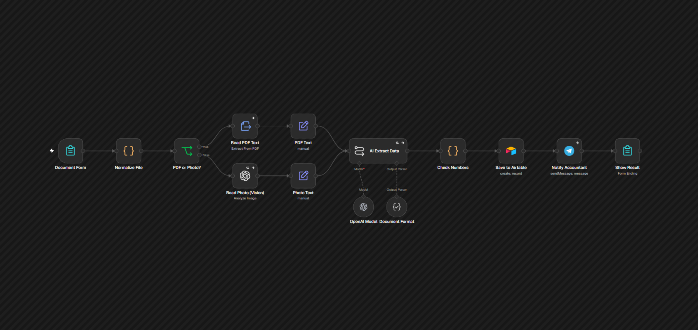

# AI Document Processing — Invoices & Receipts

Upload an invoice, receipt or act (**PDF or phone photo**) and AI extracts the vendor, number, dates, totals, tax and every line item, **double-checks the math in code**, saves the result to Airtable and notifies the accountant in Telegram. The uploader instantly sees the result and the list of problems found.

Built with **n8n** and **OpenAI** (text + vision). Demo: "Demo Accounting" (fictional).

🎬 **Demo video (Armenian):** [3-document-processing-hy.mp4](https://czibuahmksmifbzapnkv.supabase.co/storage/v1/object/public/smm-images/videos/3-document-processing-hy.mp4)
🧪 **Live demo form:** https://n8n-xwzd.srv2115236.hstgr.cloud/form/doc-ai-demo *(Russian UI; try the files in [`samples/`](samples))*

---

## Problem

Accountants in small companies retype data from dozens of invoices and receipts by hand. It is slow, boring and errors slip through: line items that don't add up to the total, overdue invoices, missing tax IDs.

## Solution

A single upload form. PDFs are read directly, photos are transcribed by a vision model, then a second AI step turns the text into structured data. A Code node verifies the numbers independently of the AI, so a wrong total is caught even if the model misses it.

## How it works


## Features

- Works with PDFs and phone photos; Russian, Armenian and English documents
- Extracts: type, vendor, number, date, due date, currency (֏ / драм / դրամ → AMD), subtotal, tax, total, line items, one-line summary
- **Math checks in code:** items vs subtotal / total / total − tax (receipts usually include VAT), subtotal + tax vs total, overdue due date
- Flags missing vendor, number or total; status `OK` or `Needs review`
- Fallbacks: if AI fails, the document is still saved and marked for manual check
- Result page right after upload + Telegram summary for the accountant

## Tech stack

`n8n (Form Trigger, Extract From File, Code)` · `OpenAI gpt-4.1-mini vision` · `OpenAI gpt-5-mini` · `Structured Output Parser` · `Airtable` · `Telegram Bot API`

## Repository structure

```
workflow/
  document-processor.json
samples/
  invoice.pdf    # fictional invoice, totals are correct
  receipt.png    # fictional receipt with a deliberate +1000 AMD error
```

## Setup

1. Import `workflow/document-processor.json` into n8n.
2. Select your own credentials (removed from the export): *OpenAI*, *Airtable token*, *Telegram Bot*.
3. Create an Airtable table with fields:
   `File Name`, `Doc Type`, `Vendor`, `Doc Number`, `Doc Date`, `Due Date`, `Total` (number), `Tax` (number), `Currency`, `Items` (long text), `Summary`, `Issues` (long text), `Status`, `Uploaded By`, `Uploaded At`.
4. Replace placeholders:

   | Placeholder | What it is |
   |---|---|
   | `YOUR_AIRTABLE_BASE_ID` | Airtable base id (`app…`) |
   | `YOUR_AIRTABLE_DOCUMENTS_TABLE_ID` | Airtable table id (`tbl…`) |
   | `YOUR_TELEGRAM_CHAT_ID` | Chat that receives notifications |

5. **Publish** and open the form URL from the **Document Form** node. Upload the files from `samples/` to test.

## Screenshots / video

- 🎬 Demo video: [watch](https://czibuahmksmifbzapnkv.supabase.co/storage/v1/object/public/smm-images/videos/3-document-processing-hy.mp4)
- 🧪 Live form: [open](https://n8n-xwzd.srv2115236.hstgr.cloud/form/doc-ai-demo)
- Sample documents: [`samples/`](samples)

**Document processor workflow**



## What I learned

- Splitting the job into "get text" (PDF reader or vision) and "understand text" (LLM with a schema) makes both steps easier to debug.
- LLMs are not calculators: arithmetic checks belong in code, the AI only extracts the numbers.
- Receipts usually show prices with VAT included — the first version reported false errors until I handled that case.
- The n8n form names the uploaded binary after the field, so a small Code node normalizes it before the rest of the flow.

---

Made by **Sergo Abrahamyan** — AI Automation Engineer, Yerevan · [LinkedIn](https://www.linkedin.com/in/sergo-abrahamyan-2b6290432/) · [GitHub](https://github.com/sergo-abrahamyan-ai)
